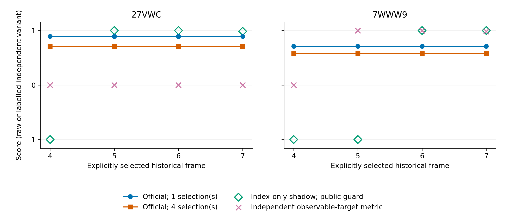

# AutumnBench execution and scoring semantics

Independent audit by **Zhijing Wu** of the pinned **public** AutumnBench Change Detection path. Does scoring preserve the selected historical answer when the user submits it?

The study executed **136 factorial scenarios**, **three separate path controls** and **eight paired original/changed replays** across two released environments (`27VWC`, `7WWW9`). It recorded **21,513 metered native calls**; scientific runner wall time was 13.1634 seconds. Seeds/repeats share deterministic worlds and are not independent environment samples.

## Findings

- All 136 scenarios follow the source-derived submission-index rule.
- At a fixed browsing cost, all 32 groups of four selected answers receive identical official scores.
- Extra selection-only browsing reduces live scores in all 48 grouped comparisons.
- A copied-index counterfactual changes 128/128 explicit-selection scores while leaving the official state unchanged.
- A separate observed-divergence target metric reverses a scripted reporting-order comparison. No learned-agent ranking was measured.



## Reproduce without native execution

Python 3.10+, standard library only:

```bash
python -B reproduce.py
```

The script unpacks retained JSON/JSONL in a temporary directory and recomputes all published summaries from actual official returns, counterfactual scores, continuous action traces and metered native records. It makes no model calls and executes no environment.

`execution_evidence/` retains official result records, action/native traces, benchmark-program reference sources and the original probe implementation. `PREREGISTRATION.json.gz` precedes primary execution; `SUPPORT_EXTENSION_PLAN.json.gz` is a separately frozen exploratory extension. `ANALYSIS_SUMMARY.json.gz` and `SCENARIO_RESULTS.json.gz` are derived records. Public portability edits and original/public hashes are recorded in [provenance](provenance/source_map.json).

## Scientific and reproduction limits

The result concerns MARAProtocol `d0d4e9251151778415cc5195c5dfb8296a5ded24` and Autumn.cpp `0929d175c3d296de091ac4b998d09b9b55a38f67`. It does not establish what code produced the paper's results, invalid published conclusions, a validated scorer repair or a complete WorldTest reproduction. The distinction between declaration latency, historical observation and latent transition activation requires author clarification.

A fresh native rerun requires Linux, the pinned MIT source trees, a built Autumn.cpp interpreter, compatible generated protobuf adapters and the separately obtained public benchmark release. The archived probes identify their required paths and source interfaces; relocate the external source/build root in a **new run directory**. This package promises portable **offline analysis**, not a turnkey native-build distribution.

Code references: [MARAProtocol](https://github.com/BasisResearch/MARAProtocol), [Autumn.cpp](https://github.com/BasisResearch/Autumn.cpp). Data and attribution: [AutumnBench / WorldTest](https://zenodo.org/records/19498269), [paper](https://proceedings.mlr.press/v306/warrier26a.html). Original audit code is MIT; benchmark data remain CC BY 4.0. [License details](THIRD_PARTY_NOTICES.md).
